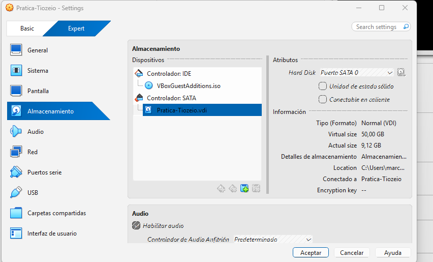
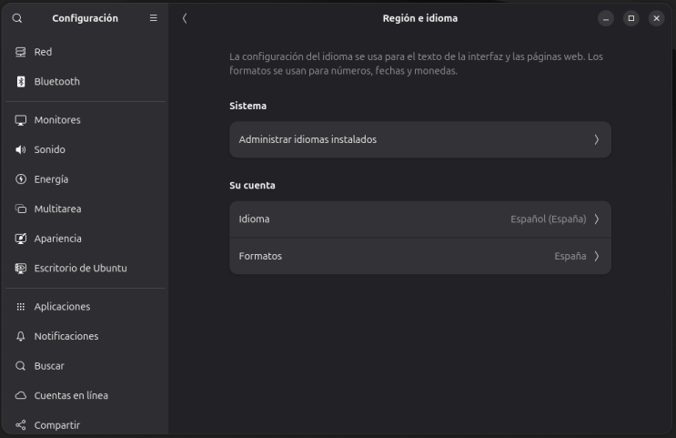
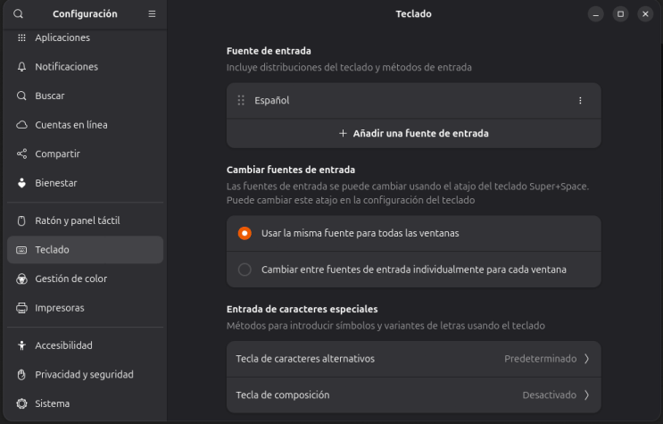
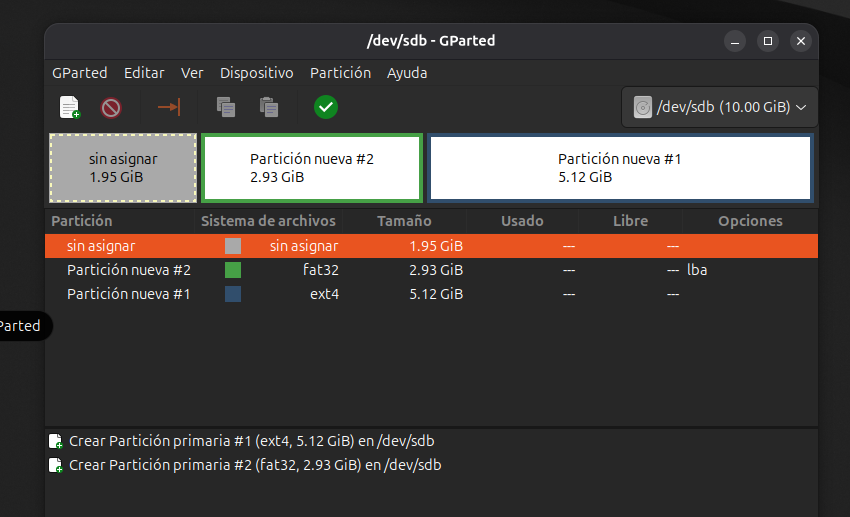
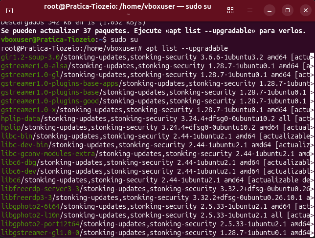
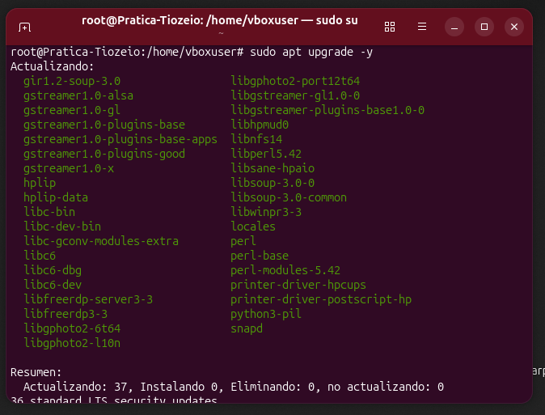

# 2.4.-Practica-Despliegue-configuracion-y-documentacion

En esta práctica instalamos Ubuntu en VirtualBox y gestionamos discos, particiones GPT y actualizaciones.

## BLOQUE 1: Despliegue y Optimización del Entorno

### 1. Planificación y Asignación de Recursos

Antes de crear la máquina virtual, revisamos el equipo anfitrión para repartir sus recursos.

**Recursos de nuestro equipo anfitrión (*Host*):**

- **Sistema operativo:** Microsoft Windows 11 Pro.
- **Procesador:** 11th Gen Intel® Core™ i5-11400 @ 2.60 GHz (6 núcleos físicos y 12 hilos).
- **Memoria RAM:** 16,0 GB instalados (15,8 GB utilizables).
- **Placa base:** Gigabyte Technology Co., Ltd. H510M H.

**Justificación técnica de los recursos asignados:**

- **Memoria RAM (4 GB):** Le asignamos 4 GB para que Ubuntu funcione con fluidez y quede memoria disponible para Windows.

  

- **Procesamiento (4 núcleos CPU):** Asignamos 4 núcleos a la máquina virtual y dejamos 2 para Windows.

  

- **Almacenamiento (VDI dinámico de 50 GB):** Elegimos **VDI** con reserva dinámica. El archivo crece según el espacio que ocupa Ubuntu, hasta un máximo de 50 GB.

  

---

### 2. Instalación Limpia

Instalamos Ubuntu con estos datos:

- **Usuario y equipo:** `vboxuser` y `Pratica-Tiozeio`.

  

- **Idioma:** Español (España).

  

- **Distribución del teclado:** Español estándar.

  

- **Contraseña:** Configuramos una clave segura, que omitimos por seguridad.

---

### 3. Optimización e Integración

Después de instalar Ubuntu, añadimos las Guest Additions de VirtualBox.

- **Guest Additions:** Comprobamos en la terminal, mediante `lsmod | grep vbox`, que el módulo `vboxguest` se cargó correctamente.
- **Resolución dinámica:** Activamos el ajuste automático de la resolución al cambiar el tamaño de la ventana.
- **Portapapeles bidireccional:** Habilitamos el intercambio de texto entre el equipo anfitrión y la máquina virtual.

> **Registro de Incidencias (Troubleshooting):** No sabíamos instalar las Guest Additions, así que buscamos una guía en internet. Insertamos la imagen del CD desde **Dispositivos > Insertar imagen de CD de las Guest Additions**, ejecutamos el instalador y reiniciamos Ubuntu.

---

### 4. Carpeta Compartida

Creamos una carpeta compartida para intercambiar archivos entre Windows y Ubuntu.

- **Ruta de origen:** `carpeta compartida`, en el Escritorio de Windows.
- **Punto de montaje:** `/media/sf_carpeta_compartida`.
- **Comprobación:** Creamos y leímos `La carpeta se compartio`; comprobamos que aparecía en Nautilus, la terminal y Windows.

---

## BLOQUE 2: Gestión de Almacenamiento, Particionamiento y Mantenimiento

### 1. Creación y Asignación de un Disco Duro Virtual Secundario

Añadimos un segundo disco desde el selector de medios de VirtualBox.

- **Nombre del archivo:** `Pratica-Tiozeio_1.vhd`.
- **Tamaño asignado:** **10,00 GB**.
- **Formato de archivo:** **VHD (Virtual Hard Disk)** con reserva dinámica.
- **Verificación:** El disco principal `Pratica-Tiozeio.vdi` (50 GB) seguía conectado y la nueva unidad estaba disponible.

---

### 2. Particionamiento GPT y Creación de Particiones

En **GParted**, seleccionamos el nuevo disco (`/dev/sdb`, 10,00 GiB) y creamos dos particiones:

1. **Partición `/dev/sdb1`:** **5.12 GiB**, formateada con el sistema de archivos **ext4**.
2. **Partición `/dev/sdb2`:** **4.88 GiB**, formateada en **fat32**.

> **Registro de Incidencias (Troubleshooting):** Al principio dividimos el disco en tres particiones por error. Reorganizamos la unidad para dejar las dos particiones previstas.

---

### 3. Redimensionado y Modificación de Particiones

Redimensionamos la segunda partición con GParted.

- `/dev/sdb2` (fat32) quedó en **2.93 GiB**; GParted mostraba **4999 MiB** como tamaño máximo.
- Quedaron **1.95 GiB** sin asignar.

---

### 4. Mantenimiento y Actualización del Sistema

Actualizamos el sistema con `apt`.

1. **Comprobación:** Ejecutamos `apt list --upgradable` como superusuario y encontramos **37 paquetes** pendientes.
2. **Actualización:** Ejecutamos `sudo apt upgrade -y`.

