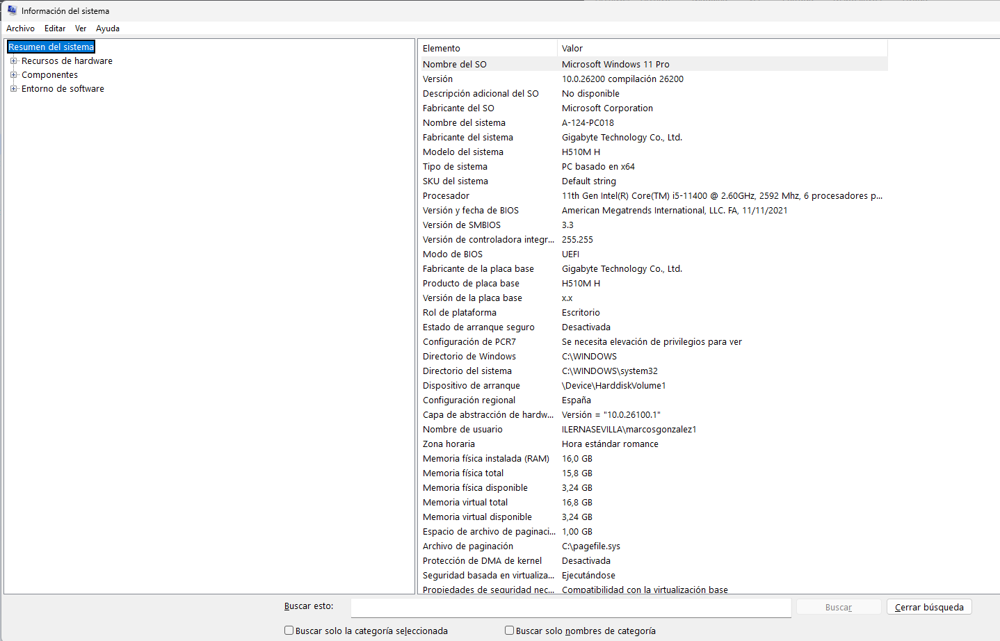

# 2.4.-Practica-Despliegue-configuracion-y-documentacion

Guía práctica sobre el despliegue de Ubuntu en VirtualBox, que abarca desde la planificación e instalación inicial del sistema hasta la gestión de almacenamiento con particionamiento GPT Y sus tareas de mantenimiento

## BLOQUE 1: Despliegue y Optimización del Entorno

### 1. Planificación y Asignación de Recursos

Antes de inicializar la máquina virtual, hacemos un análisis detallado de los componentes de hardware del equipo anfitrión para distribuir los recursos de manera eficiente.

**Recursos disponibles en el equipo anfitrión (*Host*):**
- **Sistema Operativo:** Microsoft Windows 11 Pro
- **Procesador:** 11th Gen Intel® Core™ i5-11400 @ 2.60 GHz (dispone de 6 núcleos físicos y 12 hilos)
- **Memoria RAM:** 16,0 GB instalados en el sistema
- **Placa base:** Gigabyte Technology Co., Ltd. H510M H

**Justificación técnica del reparto de recursos:**
- **Asignación de Memoria RAM (4 GB):** 

Reservamos 4 GB de los 16 GB totales del anfitrión asegura usar la máquina virtual de forma fluida sin ralentizar Windows 11.

- **Asignación de Procesamiento (4 núcleos CPU):** 

Asignar 4 de los 6 núcleos físicos del procesador i5 aporta agilidad y capacidad multitarea a la máquina virtual, reservando 2 núcleos para la estabilidad del sistema principal.

- **Amacenamiento Secundario Dinámico (VDI):** 

Para el disco principal de 50 GB seleccionamos el formato **VDI (VirtualBox Disk Image)** con reserva dinámica. 

AL elegir la **reserva dinámica**, el disco virtual solo ocupa en el almacenamiento físico del equipo anfitrión el espacio que el sistema operativo invitado va utilizando realmente, sin reservar de golpe los 50 GB en blanco.

---

