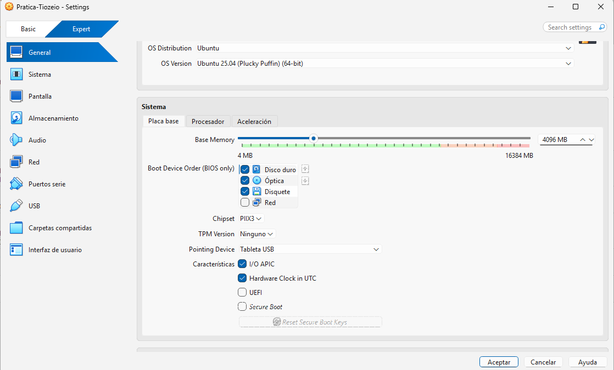
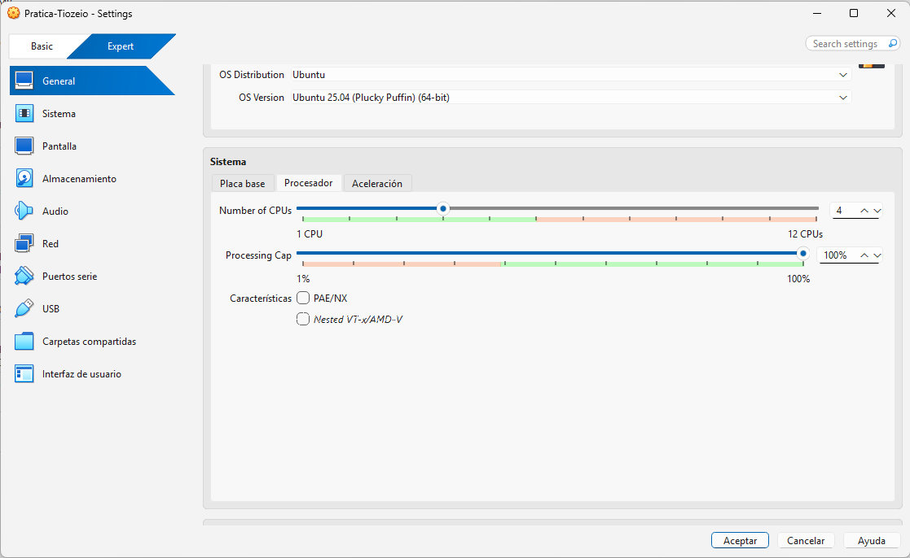
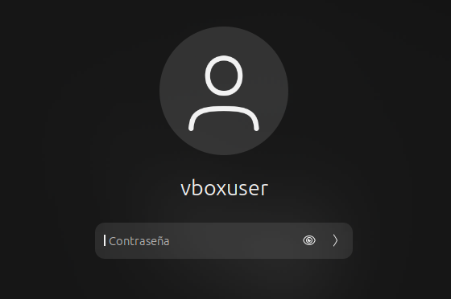
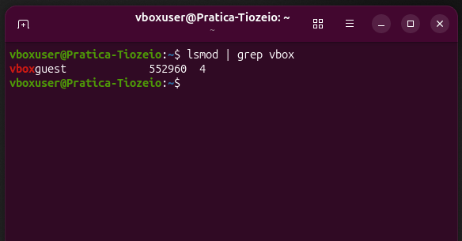
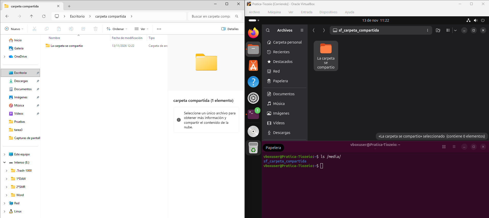
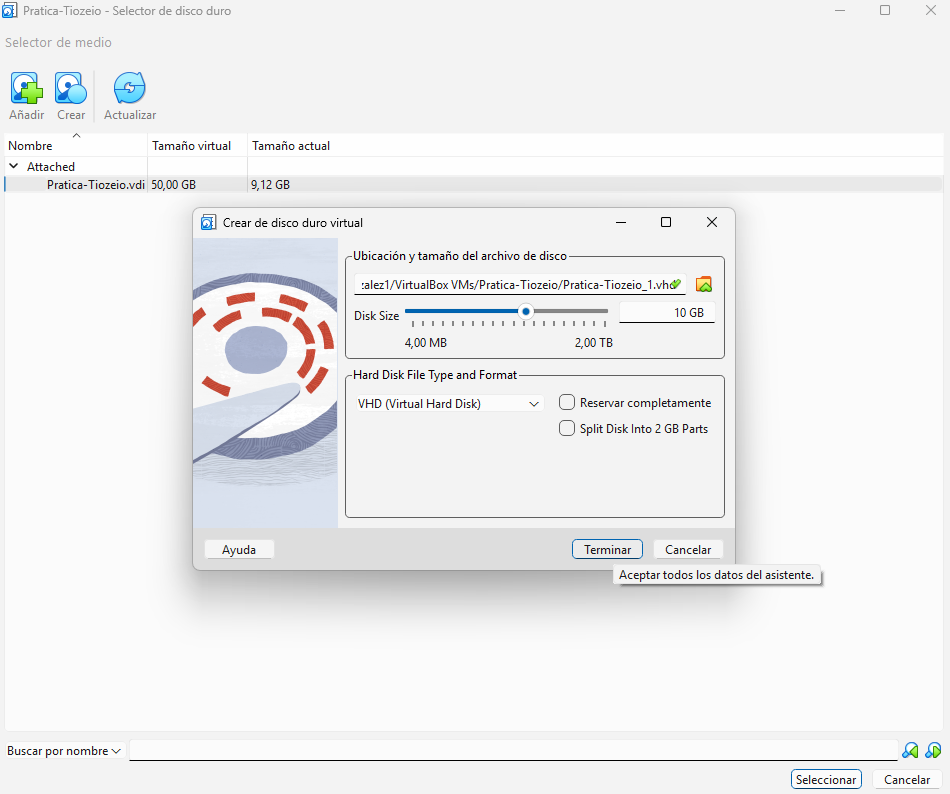
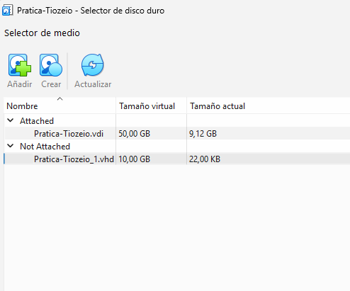
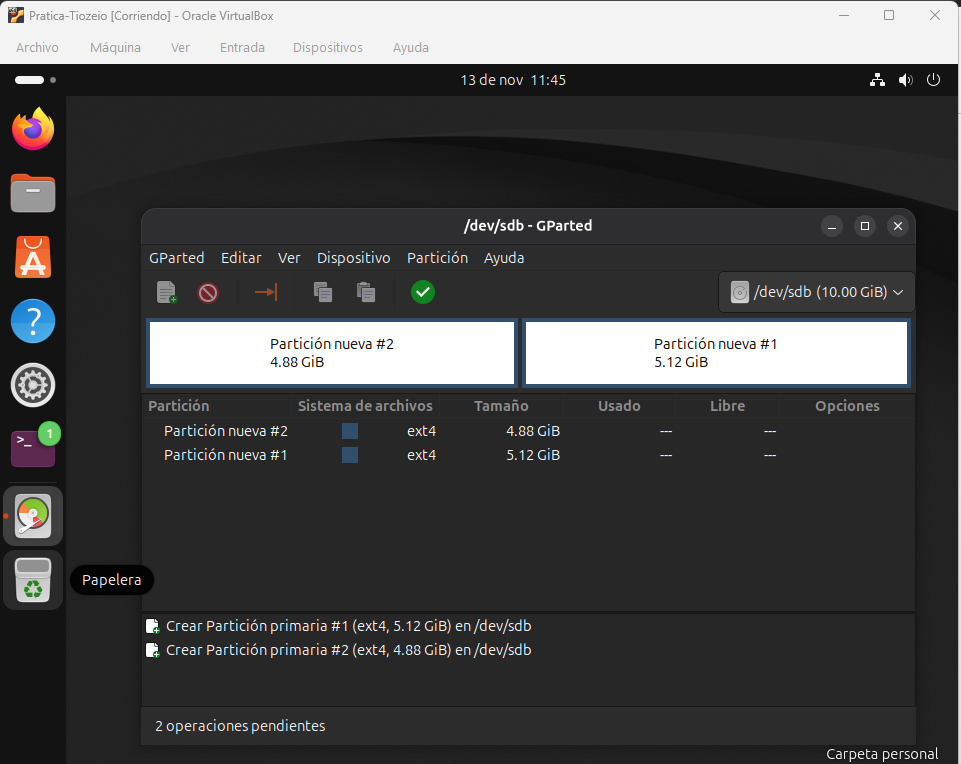
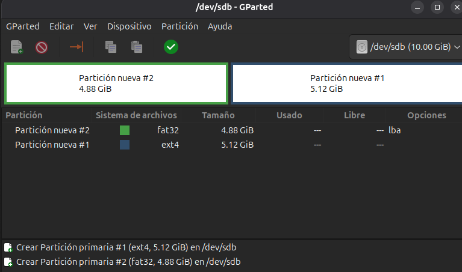
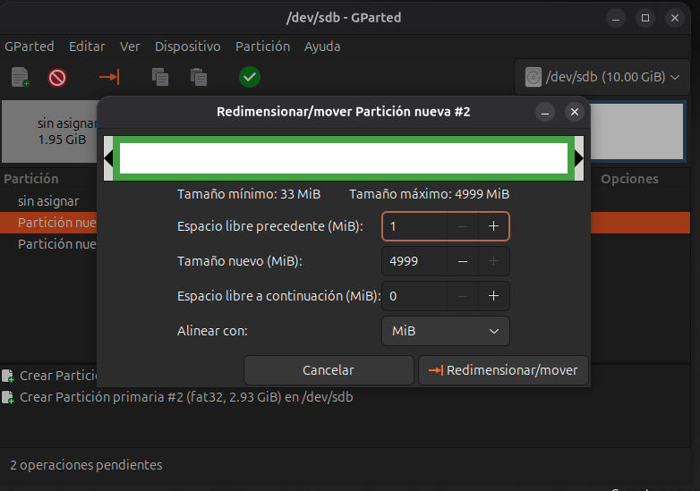

# 2.4.-Practica-Despliegue-configuracion-y-documentacion

Guía práctica sobre el despliegue de Ubuntu en VirtualBox, que abarca desde la planificación e instalación inicial del sistema hasta la gestión de almacenamiento con particionamiento GPT y sus tareas de mantenimiento.

## BLOQUE 1: Despliegue y Optimización del Entorno

### 1. Planificación y Asignación de Recursos

Antes de inicializar la máquina virtual, hacemos un análisis detallado de los componentes de hardware del equipo anfitrión para distribuir los recursos de manera eficiente.

**Recursos disponibles en el equipo anfitrión (*Host*):**
- **Sistema Operativo:** Microsoft Windows 11 Pro
- **Procesador:** 11th Gen Intel® Core™ i5-11400 @ 2.60 GHz (dispone de 6 núcleos físicos y 12 hilos)
- **Memoria RAM:** 16,0 GB instalados en el sistema
- **Placa base:** Gigabyte Technology Co., Ltd. H510M H

**Justificación técnica del reparto de recursos:**
- **Asignación de Memoria RAM (4 GB):** 

Reservamos 4 GB de los 16 GB totales del anfitrión asegura usar la máquina virtual de forma fluida sin ralentizar Windows 11.

- **Asignación de Procesamiento (4 núcleos CPU):** 

Asignar 4 de los 6 núcleos físicos del procesador i5 aporta agilidad y capacidad multitarea a la máquina virtual, reservando 2 núcleos para la estabilidad del sistema principal.

- **Amacenamiento Secundario Dinámico (VDI):** 

Para el disco principal de 50 GB seleccionamos el formato **VDI (VirtualBox Disk Image)** con reserva dinámica. 

AL elegir la **reserva dinámica**, el disco virtual solo ocupa en el almacenamiento físico del equipo anfitrión el espacio que el sistema operativo invitado va utilizando realmente, sin reservar de golpe los 50 GB en blanco.

---

### 2. Instalación Limpia

Hemos realizado la instalación de Ubuntu configurando los siguientes elementos:

**Nombre de usuario:** 

**Idioma:** Español

**Distribución del teclado:** Español 

**Contraseña:** 

Se ha establecido una contraseña segura. No se incluye en esta documentación por seguridad.

---

### 3. Optimización e Integración

Finalizada la instalación de Ubuntu, instalamos las **Guest Additions** de VirtualBox para conseguir una comunicación real entre la máquina virtual y el sistema anfitrión.

**Configuraciones e integraciones verificadas:**

- Instalamos las utilidades de VirtualBox, comprobando con \`lsmod | grep vbox\` que el módulo \`vboxguest\` se cargó correctamente.
 - Activamos el ajuste dinámico de pantalla para adaptar la resolución automáticamente al redimensionar la ventana. 
 - Habilitamos la función de copiar y pegar (portapapeles bidireccional) entre ambos sistemas.

---

### 4. Carpeta Compartida

Configuramos una carpeta compartida para intercambiar archivos rápidamente entre Windows y Ubuntu.

- **Ruta de origen en el host:** Seleccionamos la carpeta `carpeta compartida`, ubicada en el Escritorio de Windows.
- **Punto de montaje en el invitado:** Montamos la carpeta en el directorio `/media/sf_carpeta_compartida` de Ubuntu.
- **Comprobación de funcionamiento:** Verificamos el acceso creando y leyendo la subcarpeta `La carpeta se compartio`, visible desde el explorador Nautilus de Ubuntu, la terminal y Windows.

## BLOQUE 2: Gestión de Almacenamiento, Particionamiento y Mantenimiento

### 1. Creación y Asignación de un Disco Duro Virtual Secundario

Añadimos un segundo disco duro virtual a la máquina desde el selector de medios de VirtualBox.

- **Nombre del archivo:** `Pratica-Tiozeio_1.vhd`.
- **Tamaño asignado:** **10,00 GB**.
- **Formato de archivo:** **VHD (Virtual Hard Disk)** con reserva dinámica.
- **Verificación:** Confirmamos en el administrador de discos que la unidad principal `Pratica-Tiozeio.vdi` de 50 GB se mantiene conectada (*Attached*) y que la nueva unidad de 10 GB quedó lista para utilizarse.

---

### 2. Particionamiento GPT y Creación de Particiones

Abrimos la herramienta **GParted** en Ubuntu para inicializar y particionar el nuevo disco, reconocido como `/dev/sdb` (10,00 GiB). Creamos dos particiones primarias en la unidad:

1. **Partición `/dev/sdb1`:** Volumen de **5.12 GiB** formateado con el sistema de archivos **ext4**.
2. **Partición `/dev/sdb2`:** Volumen de **4.88 GiB** formateado en **fat32**.

> **Nota:** Nosotros durante la configuración inicial tuvimos problemas y dividimos el disco en tres particiones. Y luego lo arreglamos reorganizando el disco para trabajar con las dos particiones previstas.

---

### 3. Redimensionado y Modificación de Particiones

Modificamos la estructura del disco ajustando la capacidad de la segunda partición desde la herramienta de redimensionado de GParted.

- Redujimos la partición `/dev/sdb2` (fat32), que quedó con un tamaño de **2.93 GiB**. En el asistente de GParted, el tamaño máximo indicado era de **4999 MiB**.
- Tras aplicar los cambios, quedó un espacio sin asignar de **1.95 GiB** disponible para futuros usos.

---